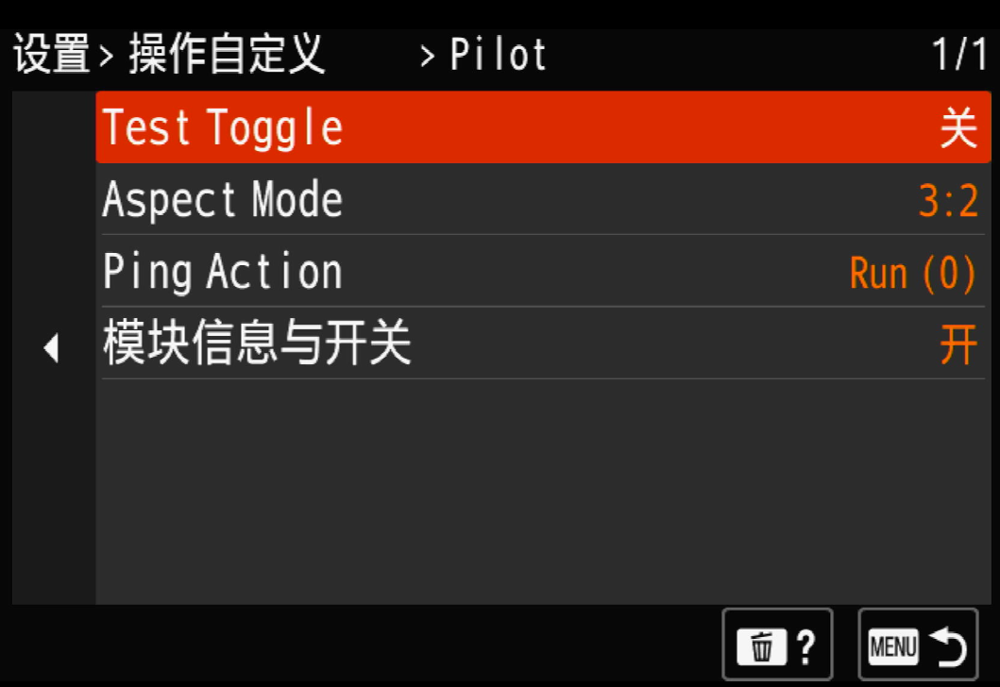

# Pilot Menu UI

在相机“自定义设置”菜单中增加 Pilot 入口，查看 Pilot 版本、模块列表、启用状态与文件路径。


## 适用机型

| 机型 | 固件 | 源码 | 状态 |
| --- | --- | --- | --- |
| ILCE-6700 | 2.00 | `pilot_menu_ui.c` | 实机验证 |
| ILCE-7CM2 (A7C II) | 2.01 | `pilot_menu_ui_a7c2.c` | 离线适配完成，功能见 [A7C2_PORT_STATUS.md](A7C2_PORT_STATUS.md) |

两份源码由 `build.sh` 按 `PILOT_MODEL` 选择，产物互不通用（模块内带机型标记，
框架会拒绝加载异机型模块）。

## 构建

```bash
# ILCE-6700 2.00
PILOT_MODEL=a6700 bash modules/menu_ui/build.sh

# ILCE-7CM2 2.01
PILOT_MODEL=a7c2 bash modules/menu_ui/build.sh
```

`build.sh` 会依次尝试 `PILOT_SYSROOT`、对应机型的 `PILOT_A6700_SYSROOT` /
`PILOT_A7C2_SYSROOT`，以及仓库旁的 `work/pilot-a7c2/sysroot`。它显式传
`-I $SYSROOT/usr/include -L $SYSROOT/lib`：交叉工具链自带的头文件是宿主 glibc
（2.38+），只有显式路径才能拿到相机的 glibc 2.25，否则产物会出现
`GLIBC_2.34`/`__isoc23_*` 依赖。构建末尾会校验 AArch64、无 TEXTREL、
`pilot_module_init`/`pilot_module_model_<model>` 符号，并拒绝 glibc 要求高于 2.25
的产物。

## 安装

1. 将 `pilot_menu_ui.so` 复制到 SD 卡的 `/pilot/` 目录。
2. 在 `/pilot/modules.txt` 的 `modules` 数组中加入 `pilot_menu_ui.so`，保留其他模块条目
   （相机文件系统不接受 `.json` 后缀，清单名为 `modules.txt`，内容仍是 JSON）。
3. 装卡并完整断电重启相机。
4. 打开“自定义设置 → Pilot”。

首次创建清单可使用：

```json
{
  "modules": ["pilot_menu_ui.so"]
}
```

## 使用

### ILCE-6700

- 选择“Pilot 版本”查看版本信息。
- 选择模块名称查看清单中的启用状态、文件路径，或进入模块注册的开关、枚举与动作子选项（`0x2A7` 选项弹窗与 `0x260` 忙等提示框）：



- 返回列表后继续选择其他模块。

模块状态来自清单配置，加载结果可查看 SD 卡的 `/pilot/log.txt`。

### ILCE-7CM2 (A7C II)

**当前不在相机菜单里提供入口。** 实测证明 A7C II 的菜单条目名称与点击目标由条目 id
查表决定（表编译在 `appFw.so` 内），描述符里的 label 与目标屏不参与，文本又是预渲染
图片；因此自定义条目必然是空行 + 「此功能被禁止」。证据与对照实验见
[A7C2_PORT_STATUS.md](A7C2_PORT_STATUS.md) 与
[a7c2_reverse_notes.md](a7c2_reverse_notes.md)。

A7C II 后端现在只做三件不侵入原厂 UI 的事：

- 读 `/pilot/modules.txt` 得到模块清单；
- 注册模块选项（`pilot_ui_register_options_v1`）；
- 安装 `TextSprite::setString` 与 `view_string::draw` 两个 hook，把自定义 RID
  （`0x02FFFxxx`）换成模块持有的字符串。

菜单注入是编译期选项（`-DPILOT_A7C2_ENABLE_MENU_INJECT`），默认关闭。打开后它会改
原生菜单表，只适合继续做实验。

模块开关用文件标记：全局 `/pilot/disable`，或 `/pilot/modules/<名>/disable`。

## 其他模块显示纯文本（仅 ILCE-6700）

公共头文件位于 `modules/menu_ui/pilot_ui.h`。在其他模块中包含它，可显示或清除 Live View 纯文本：

```c
#include "pilot_ui.h"

PilotStatus status = pilot_ui_show_text("Sensor mode ready", 3000u);
if (status != PILOT_STATUS_OK) return status;
/* duration_ms 为 0 时持续显示，直到清除。 */
status = pilot_ui_show_text("Recording mode active", 0u);
if (status != PILOT_STATUS_OK) return status;
return pilot_ui_clear_text();
```

文本使用 UTF-8，最多 159 字节；所有模块共用一条提示，新提示会替换旧提示。默认显示在左下方，使用原先 Pilot 提示的左对齐样式和录制时间的小字字体。显示时，服务核对原厂 AP `view_string` 对象，并通过 `setString(const char*)` 传入文字；每次绘制后立即恢复文字、位置和字体参数。提示清除或超时后，由正常的原厂刷新恢复显示。

调用模块需链接 `libdl.so.2`；`pilot_menu_ui.so` 必须启用并排在调用模块之前。服务未加载时返回 `PILOT_STATUS_NOT_FOUND`，Live View 钩子不可用时返回 `PILOT_STATUS_DISABLED`。

渲染实现单独位于 `pilot_lv_text_widget.inc`。日志中的 `PILOT_LV_UI_RENDER` 会记录实际进入字符串入口的次数、文字字节数和显示区域；绑定失败会记录 `PILOT_LV_UI_ERR stage=...`。

## A7C II 说明

A7C II 的菜单 UI 与 A6700 同源（索尼四代机共用一套设计），但两处根本差异决定了移植
边界：

- **没有集中 layout 数组**：控件按名字创建（`i_view::create_widget(screen_id, prop,
  count, …)` 末尾传 `"No10_Background"` 这类名字），A6700 那种「改 0x60 字节 layout 项
  的 RID」在 A7C II 上不存在。
- **菜单条目由 id 决定**：名称走 `menu::util::util_instance::get_name_resid_raw_file_type`
  （`0x01B5E140` 的 switch），目标屏同样按 id 查表；文本经
  `ResourceManager::prefetchTextImage` 预渲染成图片。描述符只提供可用性与回调。

因此 A7C II 后端保留可复用的技术积木（菜单表定位与原地写入、逐行门控
`sub_1B60228` hook、non-setting 描述符模板、`view_string::draw` 文本替换），但不向
原厂菜单里插条目。

细节与实测偏移见 [A7C2_PORT_STATUS.md](A7C2_PORT_STATUS.md) 与
[a7c2_reverse_notes.md](a7c2_reverse_notes.md)。

移植过程中的早期草稿（`A7C2_FINAL_SUMMARY.md`、`A7C2_PORTING_GUIDE.md`、`README_A7C2*.md`、
`CURRENT_STATUS.md`、`ida_tools/` 等）已归档到工作区 `tmp/menu_ui-legacy-docs/`，
其结论已被上面两份文档取代。

## 停用

从 `/pilot/modules.txt` 中移除 `pilot_menu_ui.so`，然后完整断电重启。
保留其他模块条目，可继续使用对应功能。
