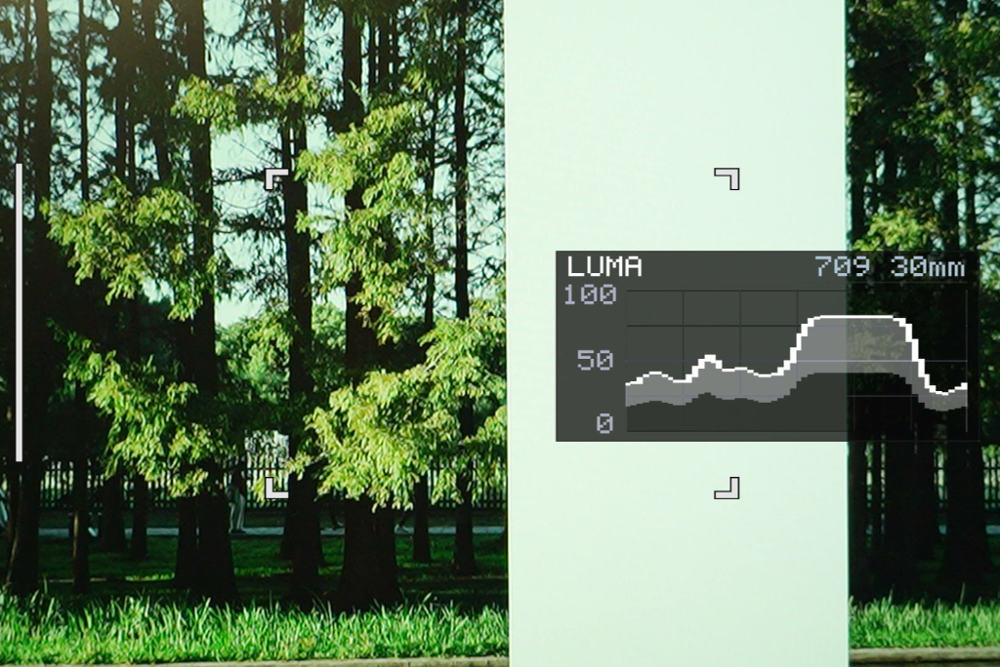
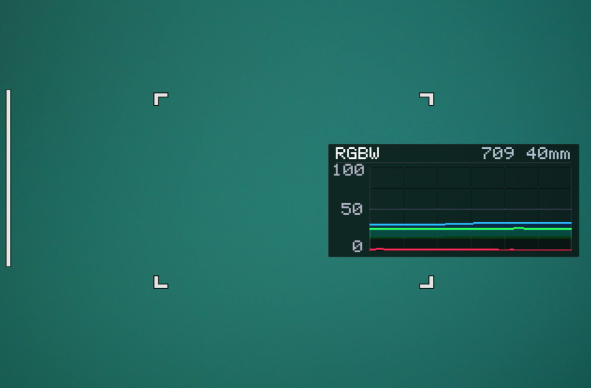

# Pilot Canvas & Live Waveform

为 ILCE-6700（固件 2.00）提供 Live View 原生画布绘制引擎与实时波形图/示波器悬浮组件，模块文件为 `pilot_canvas.so`。本目录是 Pilot 仓库中的模块实现，构建与安装约定遵循 [`docs/DEVELOPMENT.md`](../../docs/DEVELOPMENT.md)、[`docs/USAGE.md`](../../docs/USAGE.md)。

<table>
  <tr>
    <td width="50%"></td>
    <td width="50%"></td>
  </tr>
</table>

## 功能

- **实时波形图与直方图**：直接读取 CP RAM 12-bit 线性 OPD 测光网格与实时白平衡增益，在取景器（LCD / EVF）中以 10 Hz 渲染 5 种视图：
  - **RGB Parade**：R / G / B 三通道并排波形
  - **White Wave (LUMA)**：亮度波形与高亮峰值包络
  - **RGB Wave (RGBW)**：R / G / B 叠加波形
  - **RGB Hist**：0–100 IRE 三色叠加直方图
  - **Off**：隐藏示波器
- **色彩与校准**：支持 **Rec.709** / **S-Log3** 伽马曲线切换与 **WB Calib**（实时白平衡增益校准），顶栏同步显示当前曲线与镜头焦距。
- **触摸与按键交互**：
  - 点击面板循环切换波形模式；
  - 长按拖拽自由调整面板位置，自动保存至 `/pilot/modules/pilot_canvas/layout.cfg`；
  - 按相机 `DISP` 键可在“无信息”页面后切入/切出 Pilot 虚拟显示页。
- **通用绘图与多文本服务（供其他模块调用）**：通过 [`pilot_canvas.h`](pilot_canvas.h) 导出基于原生 `ux::gfxeng::Sprite` 的批量矩形、折线、网格、5×7 OSD 字体绘制接口，以及互不覆盖的多槽位 `MultiLineTextSprite` 文本接口（`pilot_canvas_text_set`）。

> **说明**：伪色（False Color）目前为实验性功能，尚在验证中，暂未在本版本作为稳定特性启用。

## 适用机型

Pilot 按机型隔离构建与加载：模块必须与框架用同一个 `PILOT_MODEL` 构建，框架在 `dlopen()` 之后、`pilot_module_init()` 之前校验模块导出的 `pilot_module_model_<model>` 标记（见 [`patch/pilot_modules.c`](../../patch/pilot_modules.c)），标记不符的模块不会执行任何初始化代码。

支持 A6700 与 A7 C II 两个机型，但覆盖范围不同：

| 机型 | 构建 | 覆盖内容 |
| --- | --- | --- |
| ILCE-6700 | `PILOT_MODEL=a6700`（默认） | 全部：画布、文本槽、触摸/DISP、CP 传感器、Live View 示波器 |
| ILCE-7CM2 | `PILOT_MODEL=a7c2` | 画布绘制 + 自建渲染层（`a7c2_host.c`） |

A6700 的 `canvas_core.c` / `canvas_text.c` / `canvas_panel.c` 使用的 appFw.so GOT 槽位（帧回调、触摸、DISP 键）与 DISP 模式 BSS 偏移都是在 ILCE-6700 2.00 上定位的，`canvas_cp_sensors.c` 的 CP RAM OPD 表、镜头信息、WB 增益与几何地址同样是 A6700 专用；A7 C II 地址不同且部分设施不存在，所以 A7C2 构建只链接 `pilot_canvas.c`、`canvas_core.c`、`a7c2_host.c` 三个源文件。

A7 C II 没有可复用的 Live View widget（A6700 由 `menu_ui` 的 `pilot_lv_text_widget.inc` 递入），因此 `a7c2_host.c` 自己用 `WidgetSystem::createLayer` 建渲染层与 widget，再绑定 canvas。详见 [`A7C2_FEASIBILITY.md`](A7C2_FEASIBILITY.md)。

**卡上文件名必须是 8.3**：相机 `Fsys` 只认 8.3 短名，`pilot_canvas.so`（16 字符）无法打开，A7 C II 请用 `CANVAS.so`（`modules.txt` 里写 `"CANVAS.so"`，扩展名必须小写）。

## 依赖

- Pilot 框架（[`patch/pilot.h`](../../patch/pilot.h)，模块 ABI 2），A6700 2.00。
- MenuUI 模块 `pilot_menu_ui.so`，且必须排在 `pilot_canvas.so` 之前加载：它提供 Live View 宿主 widget（本模块通过 `pilot_canvas_track_widget_v1` / `pilot_canvas_attach_v2` 挂接）与设置项宿主（`pilot_ui_register_options_v1`）。缺少它时模块仍能初始化，但没有可挂接的宿主页面。

## 构建

```bash
# 默认输出 build/pilot_canvas.so
bash modules/pilot_canvas/build.sh

# 显式指定 sysroot；变量名与 patch/build_pilot_dso.sh、modules/menu_ui/build.sh 都兼容
PILOT_SYSROOT=/path/to/a6700-sysroot bash modules/pilot_canvas/build.sh
PILOT_MODEL=a6700 PILOT_A6700_SYSROOT=/path/to/a6700-sysroot \
    AARCH64_CC=aarch64-linux-gnu-gcc-11 bash modules/pilot_canvas/build.sh
```

未指定 `PILOT_SYSROOT` 时依次探测 `PILOT_A6700_SYSROOT` → 从固件拆出的 `<workspace>/work/pilot-a7c2/sysroot`（需存在 `usr/include` 或 `lib`）→ 历史默认路径；未指定 `PILOT_CC` 时依次探测 `AARCH64_CC` → `aarch64-linux-gnu-gcc-11` → `aarch64-linux-gnu-gcc`。脚本会先打印实际使用的 sysroot、头目录与库目录。

sysroot 需同时提供相机自身的 C 库头文件（`<sysroot>/usr/include`）与 2.25 的桩库（`<sysroot>/lib`）。**不能用 `--sysroot` 代替**：Debian/Ubuntu 的交叉 gcc 会把它自己的 `aarch64-linux-gnu/{include,lib}` 排在 sysroot 之前，于是仍采取桌面 glibc 2.38 的头与库，产物在相机上以 ``version `GLIBC_2.34' not found`` 加载失败。脚本因此显式用 `-I` / `-L` 指向 sysroot，并在链接后校验：AArch64 架构、存在 `NEEDED`、无 `TEXTREL`、导出 `pilot_module_init`/`pilot_module_model_a6700`/`pilot_canvas_probe_v1`、无 `__isoc23_*` 引用、版本需求不高于 `GLIBC_2.25`。用相机 sysroot 构建出的产物只依赖 `GLIBC_2.17`。

## 安装

1. 将 `pilot_canvas.so` 复制到 SD 卡 `/pilot/`。
2. 在 `/pilot/modules.txt` 的 `modules` 数组中追加 `"pilot_canvas.so"`，并保证 `"pilot_menu_ui.so"` 排在它前面（参考 [`modules.example.txt`](modules.example.txt)）。清单只接受字符串数组；相机 Fsys 打不开 `.json` 文件，所以清单文件名固定为 `modules.txt`、内容仍是 JSON。
3. 装卡并完整断电重启相机。
4. 启动日志写入 `/pilot/log.txt`，本模块自己的日志在 `/pilot/modules/pilot_canvas/module.log`。

## 使用

1. 在 Live View 界面按 `DISP` 切到波形图页面，或点击/拖拽面板直接切换模式与调整位置。
2. 打开 Pilot 菜单中本模块的设置页（由 MenuUI 生成），可配置：
   - **Scope Mode**：`RGB Parade` / `White Wave` / `RGB Wave` / `RGB Hist` / `Off`
   - **Gamma Curve**：`Rec.709` / `S-Log3`
   - **WB Calib**：`Off` / `Auto`
   - **False Color**、**DISP Page**、**Lock Pos** 为附加项
3. 面板位置与这些开关保存在 `/pilot/modules/pilot_canvas/layout.cfg`（写入前有 800 ms 防抖，避免频繁写卡）。

## 停用

- 临时停用：在 SD 卡 `/pilot/` 下创建空的 `disable` 文件后重启。
- 移除模块：从 `/pilot/modules.txt` 的 `modules` 数组删除 `"pilot_canvas.so"` 后完整断电重启；也可以在 Pilot 菜单中把 **Scope Mode** 设为 `Off`，仅关闭波形绘制。
