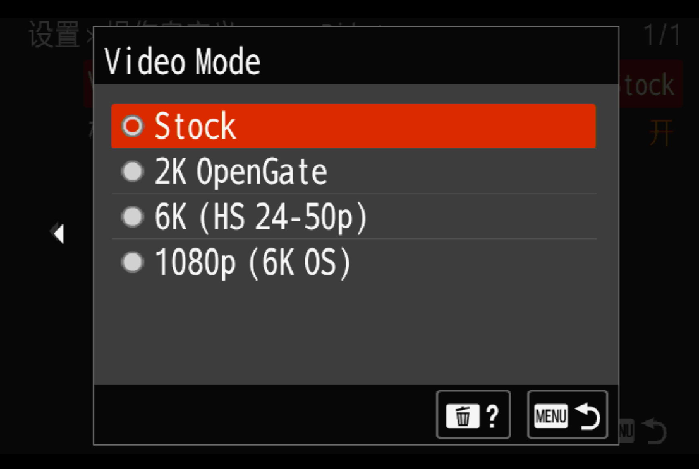

# Video Modes

为 ILCE-6700（固件 2.00）提供统一的视频模式扩展模块，模块文件为 `pilot_video_modes.so`，通过单个互斥选项在以下 4 种模式间冷/热切换：

- **Stock**：原厂默认模式
- **2K OpenGate**：在 HD 24–60p 档位输出 `1920×1280` 3:2 OpenGate
- **6K 420 (24-50p)**：在 XAVC HS 4K 24p/25p/30p/50p 档位输出 `5760×3240`
- **1080p (6K OS)**：在 HD 24–60p 档位启用 `5952×3348` 全读出超采至 1080p

## 依赖

- [Pilot v0.2.0](https://github.com/Himpq/Pilot/releases/tag/v0.2.0)（A6700）
- [MenuUI v0.2.0](https://github.com/Himpq/Pilot/releases/tag/menu-ui-v0.2.0)（需排在 `pilot_video_modes.so` 之前加载，用于提供模式切换菜单、忙等提示框与文件格式标签覆盖）

## 安装

1. 将 `pilot_video_modes.so` 复制到 SD 卡 `/pilot/`。
2. 在 `/pilot/modules.json` 中启用 `pilot_menu_ui.so` 与 `pilot_video_modes.so`（可参考 `modules.example.json`）。
3. 装卡并完整断电重启相机。

从旧版 `pilot_6k.so` 升级时，请从清单中移除 `pilot_6k.so`（以及旧版 `pilot_hs6k30_6k_ddrcd_ippp.so` / `pilot_cp_6k_og.so`），避免与本模块冲突。

## 使用

1. 打开 **设置 → 操作自定义 → Pilot → pilot_video_modes.so**。
2. 在 **Video Mode** 中选择目标模式，切换过程会弹出提示框并自动重载管线与相机菜单格式名称，配置会持久保存在模块目录 `config.txt` 中。
3. 模块日志位于 `/pilot/modules/pilot_video_modes/module.log`（或 `/pilot/log.txt`）。

## 停用

在 Pilot 菜单中将 **Video Mode** 切回 **Stock**，或从 `/pilot/modules.json` 中移除 `pilot_video_modes.so` 后完整断电重启。
